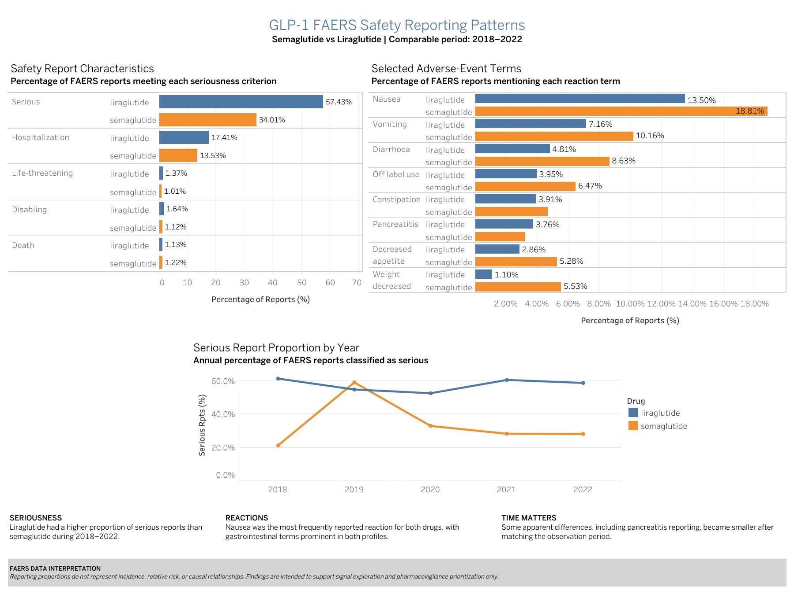
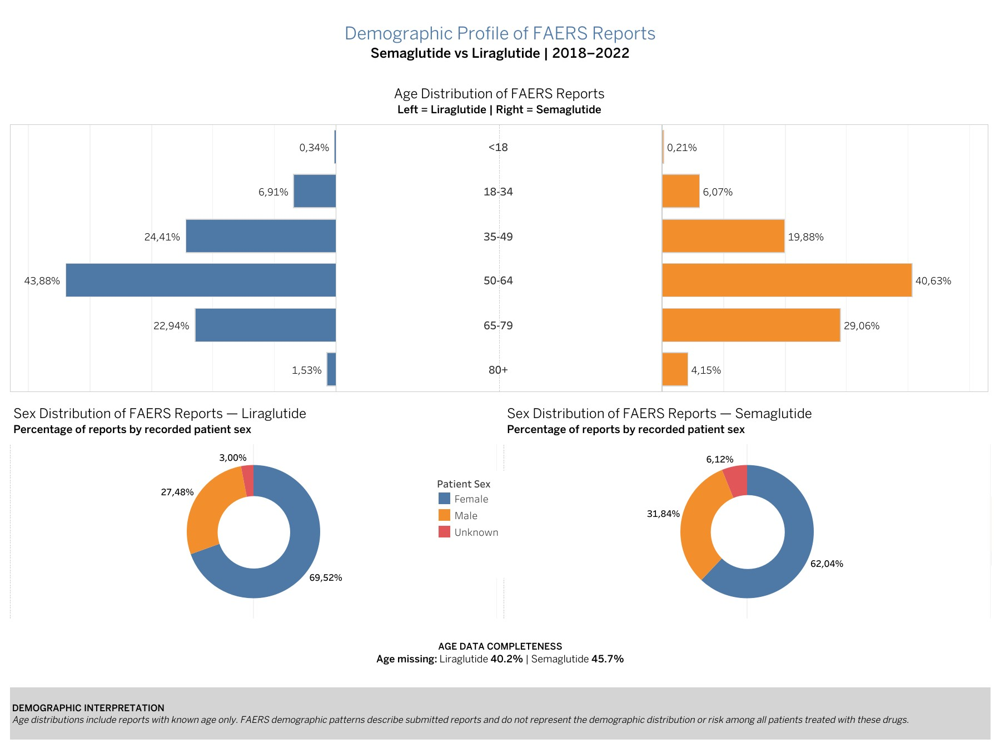

# GLP-1 FAERS Adverse Event Analysis

## Project Overview

This case study analyzes post-market adverse-event reporting patterns for **semaglutide and liraglutide** using a FAERS-derived dataset.

The project simulates a real-world pharmacovigilance analytics assignment in which a pharmaceutical company's Drug Safety and Regulatory Affairs teams want to identify reporting patterns that may warrant further investigation.

The analysis follows the **Google Data Analytics framework: Ask, Prepare, Process, Analyze, Share, and Act**.

## Business Question

**What adverse-event reporting patterns can be identified for semaglutide, and how do they compare with liraglutide to identify areas that may warrant further pharmacovigilance investigation?**

## Stakeholders

- Pharmacovigilance / Drug Safety Manager
- Regulatory Affairs Manager

## Tools

- **Python / pandas** — data preparation, transformation, exploratory and statistical analysis
- **Google BigQuery / SQL** — aggregation and independent validation of key analytical results
- **Tableau Public** — stakeholder-focused visualization and dashboard development
- **Excel / CSV** — source and analytical datasets

## Data Source

The analytical files were obtained from the **GLP-1 Weight Loss Drugs Master Dataset 2017–2026** available on Kaggle.

The adverse-event component of the dataset originates from the **FDA Adverse Event Reporting System (FAERS)** through the openFDA Drug Adverse Event API.

For this project, the main files used were:

- `adverse_events.csv`
- `data_dictionary.csv`
- `drugs_overview.csv`

The analysis focused exclusively on adverse-event reporting data relevant to **semaglutide and liraglutide**.

## Analytical Approach

### 1. Prepare

The source datasets were inspected for structure, data types, missingness, duplicate records, drug coverage, and reporting periods.

### 2. Process

Two analytical datasets were created:

- **Report-level dataset** — one row per FAERS safety report
- **Reaction-level dataset** — one row per reported adverse reaction

Reports occurring before each drug's FDA approval date were removed, data types were standardized, and analytical variables were created.

### 3. Analyze

Python and SQL were used to evaluate:

- Unique adverse-event report volumes
- Serious-report proportions
- Hospitalization, death, life-threatening, and disabling report proportions
- Most frequently reported adverse reactions
- Reaction reporting proportions
- Annual reporting patterns
- Demographic distributions
- Data completeness and missingness

Because the available reporting periods differed between the drugs, **2018–2022 was selected as the primary common full-year comparison period**.

## Key Findings

- During 2018–2022, **57.4% of liraglutide reports were classified as serious compared with 34.0% of semaglutide reports**.
- Hospitalization-report proportions were approximately **17.4% for liraglutide and 13.5% for semaglutide**.
- Death-report proportions were similar during the common period: approximately **1.13% for liraglutide and 1.22% for semaglutide**.
- **Nausea was the most frequently reported reaction for both drugs**, representing approximately **13.5% of liraglutide reports and 18.8% of semaglutide reports**.
- Semaglutide showed substantially greater **year-to-year variability in serious-report proportions**.
- Some apparent differences changed considerably after matching the observation period. **Pancreatitis reporting was an important example**, demonstrating the importance of time-matched comparisons.
- Demographic patterns showed that female patients represented the majority of reports and that the **50–64 age group** was the largest among reports with known age.

## Tableau Dashboards

### Safety & Adverse-Event Reporting Patterns



### Demographic Profile of FAERS Reports



## Interpretation

The results are intended to support **signal exploration and pharmacovigilance prioritization**, not to establish that one drug is safer than another.

FAERS is a spontaneous reporting system and does not provide the number of exposed patients. Therefore, report counts and reporting proportions cannot be interpreted as:

- Incidence
- Prevalence
- Relative risk
- Proof of causality

Differences may also reflect drug utilization, time on market, reporting behavior, indication, publicity, regulatory activity, and patient characteristics.

## Recommended Next Steps

Further investigation could include:

- Reviewing prominent reaction terms against current product labeling
- Investigating temporal changes in serious reporting
- Incorporating prescription or exposure denominators
- Comparing findings with clinical trial evidence and scientific literature
- Performing formal pharmacovigilance signal analyses
- Expanding the analysis to additional GLP-1 therapies

## Repository Structure

```text
GLP1_FAERS_Case_Study/
│
├── Data/
│   ├── Raw/
│   ├── Processed/
│   └── Analysis/
│
├── Documentation/
│   ├── GLP1_FAERS_Case_Study.docx
│   └── GLP1_FAERS_Case_Study.pdf
│
├── Notebook/
│   ├── 01_prepare_data.ipynb
│   ├── 02_process_data.ipynb
│   └── 03_analyze_data.ipynb
│
├── SQL/
│   └── glp1_faers_analysis.sql
│
├── Visualization/
│   ├── dashboard_1_safety_reporting_patterns.jpg
│   ├── dashboard_2_demographic_profile.jpg
│   └── GLP1_FAERS_Tableau_Dashboard.twb
│
└── README.md
```

## Full Case Study

The complete methodology, analytical results, dashboards, interpretation, and recommendations are available here:

[View the complete case study (PDF)](Documentation/GLP1_FAERS_Case_Study.pdf)

## Data Attribution

Dataset:

**GLP-1 Weight Loss Drugs Master Dataset 2017–2026**  
Kaggle, Version 1.0, 2026.

Underlying adverse-event source:

**FDA Adverse Event Reporting System (FAERS) / openFDA Drug Adverse Event API**

---

*This project was developed for educational and portfolio purposes. It is not intended as medical advice or as a formal regulatory safety assessment.*